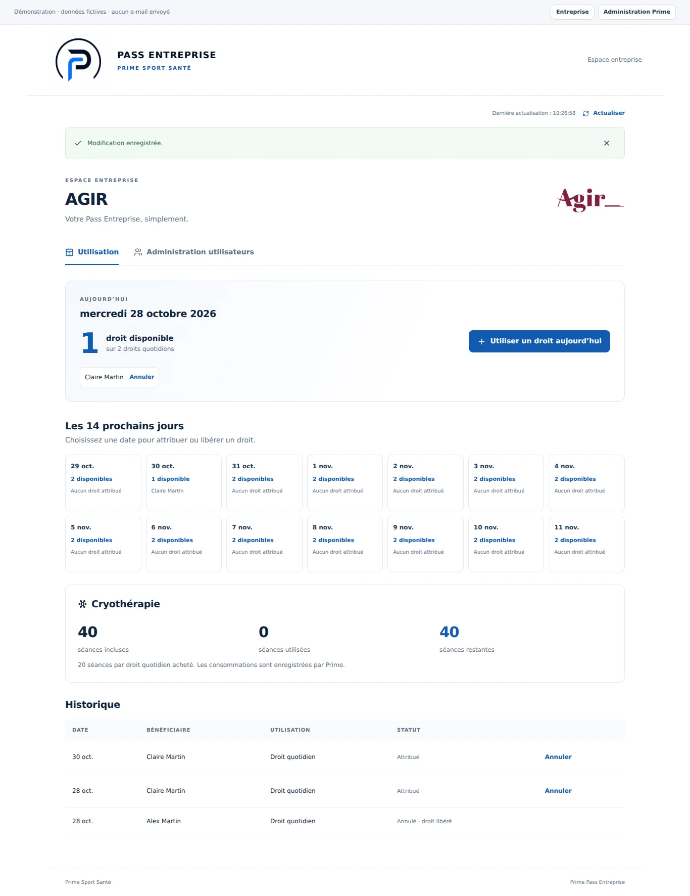
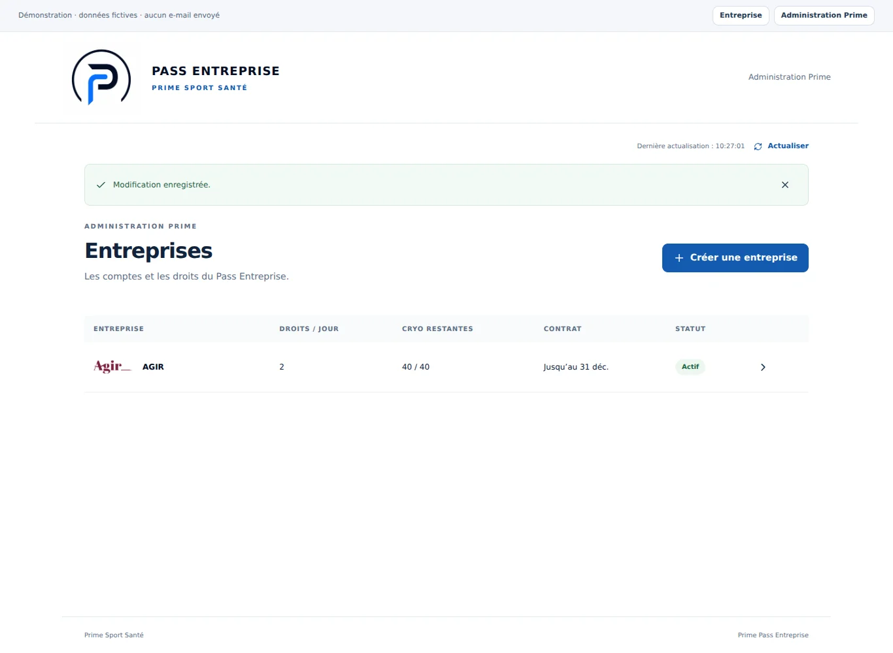

# Prime Pass Entreprise

Gestion interne des droits mutualisés du Pass Entreprise de Prime Sport Santé. Xplor reste responsable des réservations de prestations, de l’application membre et des contrôles d’accès physiques. Une attribution dans Prime Pass ne prouve pas un passage au centre.

## Deux espaces

- **Prime** : création des comptes partagés entreprise (nom, contact, e-mail, téléphone, logo facultatif, import par fichier ou collage d’image), contrats, liste des bénéficiaires, planning, consommations et corrections cryo.
- **Entreprise** : compte partagé, administration des bénéficiaires nominatifs, compteur du jour, attribution aujourd’hui et sur les 14 prochains jours, annulation libre à tout moment, quota cryo en lecture et historique.

Le quota d’un contrat est calculé en base : **20 séances cryo par droit quotidien acheté**. Les renouvellements ont leur propre période et leur propre quota ; les contrats ne peuvent pas se chevaucher. Une correction cryo exige un motif et restitue exactement un crédit. Les bénéficiaires sont désactivés sans effacer leur historique ; leur désactivation libère leurs attributions d’aujourd’hui et à venir.

## Architecture

- React / TypeScript / Vite, interface blanche, logo et monogramme Prime fournis.
- Netlify héberge uniquement l’interface statique.
- Supabase Auth gère les connexions et la récupération des mots de passe.
- L’Edge Function `prime-pass` vérifie chaque session avec `auth.getUser()`, puis appelle une fonction PostgreSQL réservée au serveur. Aucune clé serveur ne doit être ajoutée à Netlify ni à une variable `VITE_`.
- Les tables métier sont dans le schéma privé `prime_pass`, sans droit de lecture ou d’écriture pour les navigateurs. RLS y reste activée en défense supplémentaire.
- Les tables `claims` et `cryo` conservent leurs enregistrements annulés/corrigés. Les opérations sont journalisées.
- Un verrou par entreprise sérialise attributions, annulations et modifications de contrat. L’état affiché n’est modifié qu’après confirmation du serveur.
- Supabase Realtime transmet uniquement un identifiant d’entreprise et une révision via `public.prime_pass_updates`. La politique de lecture limite chaque compte à son entreprise, ou à toutes les entreprises pour Prime. Un changement déclenche la relecture de l’état métier. Actualisation de secours toutes les 60 secondes, au retour dans l’onglet et au rétablissement du réseau.
- Le jour de référence est calculé par PostgreSQL dans le fuseau `Europe/Paris`.

## État de l’installation du 28 octobre 2026

Projet Supabase : `iljpcjrzctsuluaiseww` (Prime Pass, compte Prime Sport Santé).

Les huit migrations v2 ont été installées et testées sur ce projet ; les fixtures ont été exécutées dans une transaction annulée, sans conserver de comptes ou d’entreprises fictifs. La fonction Edge `prime-pass` est déployée. Les appels sans session ou avec une session invalide sont refusés.

**À terminer avant utilisation réelle :** premier compte administrateur Prime, configuration des e-mails et des URLs Auth, et déploiement de cette branche sur le nouveau site Netlify. Les parcours de connexion réelle et d’envoi des e-mails doivent ensuite être validés de bout en bout.

AGIR et son logo servent seulement d’exemple dans le mode de démonstration explicite ; aucune fiche AGIR réelle n’est préremplie.

## Netlify

Site cible : `primepassentreprise` ; Project ID communiqué : `d0a8e3ca-e883-4f59-8ac4-188d4f49a27c`.

Relier le nouveau site à ce dépôt et à la branche de refonte. Éviter de fusionner sur `main` tant que l’ancien site Netlify suit encore cette branche si l’on veut conserver sa version actuelle.

- Commande : `npm run build`
- Dossier publié : `dist`
- Variables publiques : `VITE_SUPABASE_URL`, `VITE_SUPABASE_PUBLISHABLE_KEY` (voir `.env.example`).
- `VITE_ENABLE_DEMO=false` en production. Sans configuration, l’application montre un écran de connexion indisponible ; elle ne bascule jamais automatiquement sur des données fictives.

Le service Edge accepte par défaut l’origine `https://primepassentreprise.netlify.app`. Pour changer le domaine final, configurer `SITE_URL` dans les secrets de l’Edge Function et ajouter la même URL aux redirections autorisées de Supabase Auth. La prévisualisation `https://deploy-preview-1--primepassentreprise.netlify.app` est explicitement autorisée pour les tests. Les autres adresses de prévisualisation restent refusées. Toutes les opérations exigent une session valide, y compris sur la prévisualisation.

## Auth et e-mails

Dans Supabase Auth, définir Site URL et Redirect URLs sur l’adresse finale du nouveau site. Configurer un SMTP de production pour les e-mails aux contacts des entreprises ; le service d’envoi par défaut est limité et ne suffit pas à garantir l’envoi à des contacts externes.

1. Choisir explicitement l’adresse du premier administrateur Prime.
2. Créer/inviter cet utilisateur depuis Supabase Auth et lui faire confirmer son adresse et définir son mot de passe.
3. Exécuter `supabase/bootstrap-admin.sql` après avoir remplacé l’adresse de démonstration par cette adresse exacte. Ce script exige un utilisateur Auth existant et confirmé ; il n’envoie aucun message et ne crée aucun mot de passe.
4. Vérifier une connexion Prime, créer une entreprise de test avec une adresse que vous contrôlez, puis vérifier la connexion du compte partagé.

Il n’y a pas d’inscription libre dans l’interface. Un utilisateur Auth sans entrée dans `prime_pass.accounts` ne peut pas accéder aux données métier. Les comptes entreprise sont créés par Prime avec un mot de passe aléatoire non divulgué ; le contact reçoit un lien pour choisir le sien. Si l’envoi échoue, la fiche est conservée et Prime peut renvoyer le lien depuis la console.

## Installation d’une nouvelle base

Sur une base vierge, exécuter dans cet ordre :

1. `supabase/prime_pass_v2.sql`
2. `supabase/realtime.sql`
3. `supabase/vip_sales.sql`
4. `supabase/subscriptions.sql`
5. `supabase/admin_discounts.sql`
6. `supabase/subscription_notifications.sql`
7. `supabase/client_lifecycle.sql`
8. `supabase/subscriber_receipts.sql`
3. Déployer `supabase/functions/prime-pass/index.ts` et son module partagé.

La vérification JWT de la passerelle Edge est désactivée au profit de la validation explicite de la session dans le handler (`auth.getUser(token)`) avant toute opération métier. Aucune action métier n’est anonyme. Les clés serveur proviennent uniquement des variables automatiques Supabase `SUPABASE_SECRET_KEYS` ou de leur équivalent historique.

L’ancienne migration de septembre est conservée sous `supabase/legacy/` pour référence, et ne doit pas être appliquée à la v2. Les fichiers SQL à la racine de `supabase/` sont les sources lisibles testées. Les copies dans `supabase/migrations/` correspondent aux versions effectivement générées par Supabase pour ce nouveau projet.

Les onze avis informatifs « RLS enabled, no policy » du schéma privé sont attendus : les accès directs sont intentionnellement refusés ; seul le serveur utilise ces tables. La table publique de notification dispose de sa propre politique. Voir [la documentation du contrôle RLS](https://supabase.com/docs/guides/database/database-linter?lint=0008_rls_enabled_no_policy).

## Développement et vérification

```bash
npm ci
npm test
npm run typecheck:server
npm run build
npm run dev -- --host 127.0.0.1
```

Node 22.6 ou plus récent est requis pour les tests TypeScript natifs ; Node 24 recommandé.

Pour une démonstration **locale et explicitement signalée** :

```bash
VITE_ENABLE_DEMO=true npm run dev -- --host 127.0.0.1
```

Ouvrir `/?demo=1`. Les actions utilisent uniquement le stockage local du navigateur et n’envoient aucun e-mail. Le mode démo n’est pas une simulation des protections du serveur : celles-ci sont vérifiées séparément par les tests PostgreSQL.

Les tests couvrent la séparation des comptes, le refus des écritures directes, les quotas, les répétitions de requêtes, les annulations, les corrections cryo, les renouvellements et les notifications filtrées.

## Aperçus vérifiés

Les captures utilisent exclusivement des données fictives signalées dans l’interface.





## Suivi du canal VIP JL Bourg

L’administration dispose d’un onglet « VIP individuels et TNS ». Une fiche conserve les identités du titulaire et de son associé éventuel, les coordonnées, le profil, la période et le prix total payé. Aucun compte de connexion individuel n’est créé. Les modifications et suspensions sont historisées dans le journal Prime, sans suppression des fiches.

Tarifs annuels de référence : individuel 1 890 € TTC + duo 800 € TTC ; dirigeant 1 690 € HT + duo 800 € HT ; entreprise 2 690 € HT pour le premier droit quotidien + 1 690 € HT par droit supplémentaire. Le montant total payé est modifiable ; il ne change plus automatiquement après une saisie manuelle, sauf clic sur « Appliquer le tarif ». Les prix historiques inconnus des entreprises restent à renseigner.

L’accueil additionne les droits quotidiens des contrats entreprises actifs, les titulaires VIP et leurs associés duo. Un duo compte deux personnes, un seul droit alterné. Le calcul exclut les périodes futures ou expirées et les comptes suspendus. Les trois compteurs financiers portent sur les prix payés des contrats actifs, duo compris, avec HT et TTC séparés ; ce ne sont pas des cumuls comptables annuels. Les VIP ne sont accessibles qu’à l’administration. Ils sont actualisés au chargement, au retour dans l’onglet, par le bouton Actualiser et au plus tard par le rafraîchissement périodique de 60 secondes.

Vérification Supabase Auth : la protection contre les mots de passe compromis est désactivée dans le projet ; réglage indépendant de ce suivi VIP. [Configuration et disponibilité](https://supabase.com/docs/guides/auth/password-security#password-strength-and-leaked-password-protection).

## Souscriptions publiques

URL : `/souscription`, sans compte. La page recueille les coordonnées du contact, l’offre, la quantité et, pour les particuliers/dirigeants, chaque titulaire et son duo éventuel. Les tarifs annuels sont recalculés dans PostgreSQL. L’entreprise demande un nombre de droits quotidiens ; ses bénéficiaires seront ajoutés dans son espace après activation. Aucun règlement n’est collecté sur cette page.

La fonction Edge séparée `prime-subscribe` expose uniquement l’état de campagne (GET) et le dépôt (POST). Elle ne donne accès ni aux demandes existantes ni aux opérations d’activation. La clé secrète reste côté serveur. Les tables restent privées et le RPC ne peut être exécuté que par le service serveur. Protection de base : origine, limite de taille, champ piège, limitation par adresse déclarée et empreinte IP, plafond global, UUID de requête conservé après un échec. L’adresse déclarée n’est pas considérée comme vérifiée. Aucune vérification email n’est simulée.

Prime consulte « Souscriptions », ouvre/ferme la campagne, consulte les identités et coordonnées, classe une demande sans suite ou confirme le règlement avec dates et montant réellement payé. La validation crée les VIP ou le compte partagé entreprise/contrat et modifie les compteurs. Les demandes en attente n’augmentent pas les compteurs actifs ou financiers. Les validations sont transactionnelles et historisées ; une validation déjà enregistrée ne recrée pas de fiches. Pour plusieurs adhésions, le prix payé est réparti au prorata des tarifs, en centimes, avec reliquat sur la dernière adhésion.

La création du compte entreprise demande un email de définition du mot de passe via Supabase Auth, avec retour vers la prévisualisation lorsque la validation y est effectuée. Ajouter `https://deploy-preview-1--primepassentreprise.netlify.app` aux Redirect URLs Supabase pour tester ces liens. Le SMTP Auth est configuré par le propriétaire avec l’expéditeur `Prime Sport Santé <vip@primesportsante.fr>` et le compte d’envoi Google principal `admin@primesportsante.fr`.

**Notifications de souscription :** le dépôt déclenche un email récapitulatif à `vip@primesportsante.fr`, expéditeur `Prime Sport Santé <vip@primesportsante.fr>`, via Google SMTP/TLS 465. Les identifiants sont des secrets Edge (`SMTP_HOST`, `SMTP_PORT`, `SMTP_USER`, `SMTP_PASSWORD`, `SMTP_FROM`, `SUBSCRIPTION_NOTIFY_TO`), indépendants du SMTP Auth. Le mot de passe est celui d’une application Google du compte principal `admin@primesportsante.fr` ; ses espaces de présentation sont retirés à l’envoi. Ne jamais récupérer le mot de passe SMTP Auth en SQL ni placer des secrets dans le frontend. Le transport Nodemailer est épinglé à `10.2.1` dans le module serveur, avec validation TLS et délais bornés.

## Conditions tarifaires réservées à Prime

Sur les créations, contrats existants et validations de souscriptions, Prime peut choisir « Réduction JL Group −20 % » ou « Gratuité », sans cumul. La réduction porte sur le tarif complet annuel, y compris les duos. Le choix remplit le prix payé avec le montant calculé ; le montant réellement réglé reste modifiable hors gratuité. Une gratuité impose un prix payé de zéro, vérifié aussi en base.

Les contrats et VIP conservent la condition choisie. Les tarifs de référence et prix après réduction sont des colonnes calculées par PostgreSQL à partir de l’offre ; le client ne peut pas les falsifier. Les écritures restent réservées à Prime et sont historisées. La page publique ne présente aucune réduction et son endpoint rejette les tentatives de choix d’une réduction.

Les fiches entreprises affichent « Tarif et règlement » dès leur ouverture avec un accès direct à la modification du tarif. Le récapitulatif est également présent dans chaque contrat et sur les VIP existants. Les prix historiquement renseignés sont conservés ; les prix inconnus restent « À renseigner ». Les compteurs financiers additionnent les prix payés, donc zéro pour une gratuité, et le compteur des personnes inclut toujours ces contrats actifs.

## Fiabilité des notifications

L’état, les tentatives et la date d’envoi restent attachés à la demande. Une prise de verrou et un jeton de tentative empêchent les doubles envois concurrents. Une nouvelle soumission du même UUID ne renvoie pas un email déjà tenté. Prime peut relancer une notification en attente/échouée depuis la fiche ; délai minimum d’une minute, récupération d’un envoi interrompu après cinq minutes. Une notification acceptée par le serveur SMTP n’est pas renvoyée. Le message a un identifiant stable par demande. Il reste une incertitude en cas de coupure après acceptation SMTP mais avant confirmation en base : une relance manuelle peut alors produire un doublon, la livraison SMTP n’étant pas transactionnelle avec PostgreSQL.

La demande est confirmée au souscripteur même si Gmail échoue. Seules des catégories d’erreur sont conservées ; aucun mot de passe ou message SMTP brut n’est exposé. La notification interne utilise uniquement l’adresse VIP configurée ; l’accusé de réception utilise uniquement l’adresse enregistrée dans la demande. L’expéditeur reste l’adresse VIP, et les notifications reprennent les données enregistrées, jamais un corps de mail ou un destinataire fournis par le client. L’email pointe vers `/?view=subscriptions`, la connexion Prime restant obligatoire. Le souscripteur reçoit également un accusé de réception, dont l’état et les relances sont indépendants de la notification Prime.

L’état « Envoyé » signifie que le serveur SMTP a accepté le message. Il ne constitue pas une preuve de réception dans la boîte finale ou de lecture. Les identifiants Google restent exclusivement dans les secrets de fonction.

## Clients désactivés

Les boutons « Supprimer le compte entreprise » et « Supprimer le VIP » demandent confirmation et désactivent la fiche. Elle quitte les listes actives et les compteurs pour rejoindre « Clients désactivés ». L’espace entreprise est bloqué immédiatement par les contrôles d’autorisation serveur ; les attributions à compter d’aujourd’hui sont annulées. Les anciens contrats sont clôturés via `retired_at`, leurs dates et consommations étant conservées pour l’historique.

La réactivation exige une nouvelle période, les nouveaux droits entreprise (quota cryo neuf de 20 séances par droit), ou le profil et duo VIP, le prix payé et une condition tarifaire Prime. Les anciens contrats entreprise ne sont jamais réutilisés. Les changements VIP conservent les anciennes conditions dans l’audit. Le serveur interdit de réactiver une fiche par le simple formulaire de modification.

La suppression définitive n’est possible que sur une fiche inactive, après saisie exacte du nom. L’entreprise est effacée avec ses bénéficiaires, contrats, utilisations, notifications/demandes liées et opérations contenant ses données. Les comptes de connexion sont retirés de l’application avant leur suppression via Supabase Auth. Une file privée `auth_cleanup` permet de reprendre cette dernière étape après un échec réseau lors du prochain chargement de la console Prime ; aucun accès applicatif ne subsiste entre-temps. Aucun compte Auth n’est supprimé par SQL. Les suppressions VIP effacent la fiche et les audits associés. Dans une demande regroupant plusieurs VIP, seule l’identité du VIP supprimé est masquée et les autres clients sont conservés. Une trace minimale de suppression, sans nom, reste dans le journal.

Les opérations passent par un RPC interne réservé au serveur, qui vérifie le rôle Prime, verrouille la fiche et contrôle son état et la confirmation. Les tests de suppression utilisent exclusivement des fixtures isolées ; aucune fiche client réelle n’est supprimée pour vérifier le déploiement.

## Accusé de réception au souscripteur

Après chaque dépôt, un second email part de `vip@primesportsante.fr` vers l’adresse du contact enregistrée en base, avec récapitulatif de l’offre, quantité, options et montant demandé. Il précise que le lien de paiement suivra et que l’activation exige la validation Prime. Pour une demande déjà activée, le texte confirme ce statut et précise qu’il ne s’agit pas d’une nouvelle demande de paiement. Aucune URL d’administration n’est incluse dans l’accusé destiné au client ; ses réponses arrivent à VIP.

Les colonnes `receipt_*` et le RPC interne `prime_pass_receipt` suivent cet envoi indépendamment des colonnes `notification_*`. Les deux envois ont des identifiants différents, des verrous et des délais de relance distincts. La console présente les deux états et un bouton pour relancer chaque email non envoyé, sans répéter celui déjà accepté par SMTP. Les jetons de tentative ne sont jamais renvoyés à la console. Les anciens dossiers restent « À envoyer » pour l’accusé ; il n’y a pas d’envoi massif rétroactif.

Vérification du raccordement des accusés : l’envoi vers le contact de la demande Game Plan existante a été accepté par Gmail, avec `receipt_status=sent`, une seule tentative et aucune erreur. La notification interne déjà envoyée n’a pas été répétée.

## Présentation des emails de souscription

Les notifications internes et accusés de réception disposent d’une version HTML et d’une alternative texte. Le modèle utilise une carte blanche, des titres bleu Prime, un récapitulatif et une pile typographique sans empattement (police système, Segoe UI, Arial). Il ne dépend d’aucune police distante. Le logo officiel est un PNG optimisé inclus dans le message via une pièce inline CID, sans URL d’image Netlify ou téléchargement distant.

Les informations saisies sont échappées avant insertion HTML ; seuls les emails internes ont un bouton vers la console. Le modèle a été inspecté sur ordinateur et mobile, et les tests vérifient l’image embarquée, la version HTML, la présence de l’alternative texte et l’échappement des contenus. La présentation finale peut varier selon le logiciel de messagerie. Ces modèles concernent les emails envoyés par les fonctions de souscription ; les modèles d’authentification restent gérés séparément dans Supabase Auth.

## Modèle HTML Supabase Auth prêt à installer

Le fichier `supabase/templates/recovery.html` harmonise les emails de première définition et de réinitialisation du mot de passe avec la charte Prime. La procédure d’enregistrement et l’objet figurent dans `supabase/templates/README.md`. Ce modèle est préparé et versionné ; il doit être enregistré dans Supabase Auth Email Templates pour devenir actif. La connexion Supabase actuelle ne permet pas d’éditer ce paramètre.

Le logo des modèles Supabase Auth est disponible publiquement sur `https://iljpcjrzctsuluaiseww.supabase.co/functions/v1/prime-assets/prime-logo.png`. La fonction `prime-assets` accepte uniquement GET/HEAD et retourne le PNG officiel, sans accès à la base ni aux secrets. Si un modèle a déjà été collé dans Supabase, remplacer son ancienne URL GitHub par cette URL.
